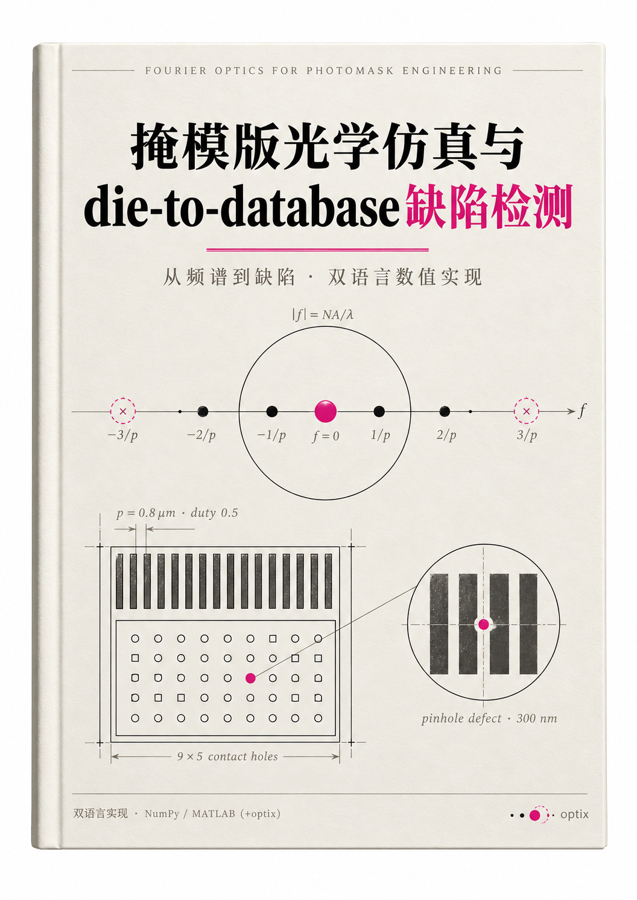

    

  # 掩模版光学仿真与 die-to-database 缺陷检测

  **从波动光学基础到参考图渲染仿真的完整中文教材 · 四篇十九章 + 七附录**

  
  
  
  

  **[📖 免费在线试读](https://jiejin93.github.io/optic-textbook/)** · [试读章节源文件](./trial/)

---

## 这本书讲什么

面向**零光学基础**、有 Python/NumPy 工程背景的读者，目标只有一个：能独立理解并实现掩模缺陷检测（die-to-database）背后的**参考图渲染仿真**——这是工业光学会真正在运转的核心算法之一。

## 这本书的特点

- **真实计算，不画示意图**：全书插图由仿真数据生成，正文引用的每个数值都可由测试复现（12 项基准，Python 与 MATLAB 双语言互相咬合）；
- **仿真模块化主线**：版图栅格化 → Abbe 源点引擎 → Hopkins/TCC 快速引擎 → 厚掩模矢量仿真 → 参考图渲染与设备标定，五步直通 D2DB；
- **零基础友好**：每章固定节奏——学习目标 → 逐步推导（保留中间步骤）→ 小结 → 习题；
- **双语言实现**：`opticsim`（Python，纯 NumPy）与 `+optix`（MATLAB，30 函数包）。

## 完整目录

| 部分 | 章节 | 试读 |
|------|------|:---:|
| **一 · 基础篇** | 绪论 · 复数与波动 · 傅里叶分析 · 线性系统与采样 · 电磁场与光波 · 光与物质 · 干涉与相干 · 衍射理论 | [前言+1~4 章](https://jiejin93.github.io/optic-textbook/) |
| **二 · 成像理论篇** | 透镜=傅里叶变换机 · PSF/OTF 与分辨率 · 从阿贝到 Hopkins | — |
| **三 · 仿真篇**（重点） | 掩模工程与版图 · 栅格化与薄掩模 · Abbe 引擎 · Hopkins/TCC · 厚掩模矢量仿真 · 参考图渲染与标定 | — |
| **四 · 应用篇** | D2DB 检测算法全流程 · 综合实战与工程化 | — |
| **附录 A–G** | 公式速查 · 术语对照 · 参考文献 · 习题解答 · Mini-D2DB 实验指南 · 十个数值实验 · 调试手册 | — |

## 获取完整版

添加作者微信购买（备注 **光学教材**），试读满意再入手：

| 版本 | 内容 | 价格 |
|------|------|-----|
| **教材完整版** | 19 章 + 7 附录，A4 排版 PDF，勘误免费更新 | **¥59.9** |
| **教材 + 运行代码** | 上述全部 + `opticsim` Python 库 + `+optix` MATLAB 工具箱 + 12 项验证测试 + 全部插图复现脚本 + 端到端 D2DB 流水线 | **¥99.9** |

## 本书如何写成的

写作中使用了 AI 辅助（结构设计、初稿与代码生成），并经过多轮人工审校；参考了国内外公开教材、论文与开源资料，详见各章"参考文献"。

## License

试读章节与配套代码：CC BY-NC 4.0（署名-非商业）；完整版内容：保留所有权利，禁止转载/售卖。

---

📚 姊妹篇：<a href="https://github.com/jiejin93/llm-textbook">《大模型：从 Transformer 到部署》</a>（309 页，Transformer → RLHF → 量化部署 → 视觉语言模型）

